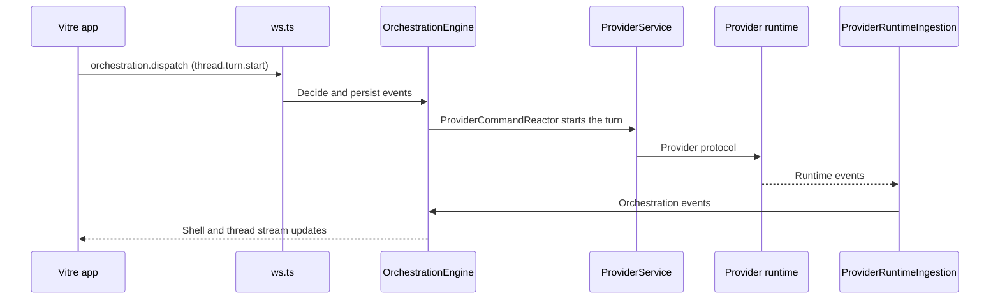
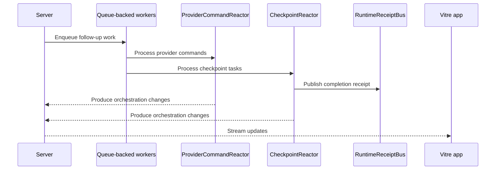

# Architecture

Vitre is a native macOS app written in Rust with GPUI. It bundles a Node.js server (the sidecar)
that runs provider sessions and owns conversation state. The app is a client of that server over
the same HTTP and WebSocket Effect-RPC contract any other client would use.

```
┌────────────────────────────────────────┐
│  crates/vitre-app (Rust, GPUI)         │
│  vitre-state: reducers and view state  │
│  vitre-client: shell/thread streams    │
│  vitre-rpc: HTTP + WebSocket RPC       │
└──────────┬─────────────────────────────┘
           │ loopback HTTP + WebSocket
┌──────────▼─────────────────────────────┐
│  apps/server (Node.js sidecar)         │
│  OrchestrationEngine (event sourced)   │
│  ProviderService + provider drivers    │
│  CheckpointReactor, RuntimeReceiptBus  │
└──────────┬─────────────────────────────┘
           │ stdio / SDKs
┌──────────▼─────────────────────────────┐
│  Codex app-server, Claude Agent SDK,   │
│  Cursor and Grok (ACP), OpenCode       │
└────────────────────────────────────────┘
```

## Components

- **Native app**: [`crates/vitre-app`][1] renders conversations, files, diffs, the terminal and the
  browser preview. [`vitre-sidecar`][2] starts and supervises the bundled server, and
  [`vitre-rpc`][3] keeps one authenticated connection to it, reconnecting when it drops.
  [`vitre-client`][4] turns the server's shell and thread streams into watch channels, and
  [`vitre-state`][5] holds the reducers the views read from.

- **Contracts**: [`packages/contracts`][6] defines every RPC method and payload with Effect Schema.
  `scripts/vitre/export-contracts.ts` exports them as JSON Schema and `vitre-contracts-gen`
  generates the matching Rust types in `crates/vitre-contracts`. CI fails if the generated
  code drifts from the TypeScript source.

- **Server**: [`apps/server`][7] accepts the app's requests ([`ws.ts`][17]), persists
  orchestration events in SQLite, and projects them into the read model the app subscribes to.

- **Providers**: each provider is a driver ([`builtInDrivers.ts`][18]). Codex runs as
  `codex app-server` over JSON-RPC on stdio; Claude runs through the Claude Agent SDK; Cursor and
  Grok speak ACP; OpenCode uses its SDK. [`ProviderRuntimeIngestion`][9] translates their events
  into orchestration events.

- **Background workers**: long-running flows such as runtime ingestion, command reaction, and
  checkpoint processing run as queue-backed workers. This keeps work ordered and gives tests a
  deterministic way to wait for the system to go idle.

- **Runtime signals**: the server emits typed receipts when important async milestones finish,
  such as checkpoint capture, diff finalization, or a turn becoming fully quiescent. Tests and
  orchestration code wait on these instead of polling internal state.

## Event Lifecycle

### User turn flow



1. The app sends a typed command such as `thread.turn.start` over the WebSocket.
2. [`OrchestrationEngine`][10] decides the command, persists the resulting events, and updates the
   read model.
3. [`ProviderCommandReactor`][13] reacts to the new intent and asks [`ProviderService`][8] to start
   or resume the provider session.
4. Provider events come back through [`ProviderRuntimeIngestion`][9] as orchestration events.
5. The app receives the changes on its shell and thread subscriptions.

### Async completion flow



1. Some work continues after the initial request returns, especially in [`ProviderRuntimeIngestion`][9], [`ProviderCommandReactor`][13], and [`CheckpointReactor`][14].
2. These flows run as queue-backed workers using [`DrainableWorker`][16], which helps keep side effects ordered and test synchronization deterministic.
3. When a milestone completes, the server emits a typed receipt on [`RuntimeReceiptBus`][15], such as checkpoint completion or turn quiescence.
4. Tests and orchestration code wait on those receipts instead of polling git state, projections, or timers.
5. Any user-visible state changes produced by that async work reach the app through the same
   shell and thread subscriptions.

[8]: ../../apps/server/src/provider/Layers/ProviderService.ts
[9]: ../../apps/server/src/orchestration/Layers/ProviderRuntimeIngestion.ts
[10]: ../../apps/server/src/orchestration/Layers/OrchestrationEngine.ts
[11]: ../../packages/contracts/src/orchestration.ts
[13]: ../../apps/server/src/orchestration/Layers/ProviderCommandReactor.ts
[14]: ../../apps/server/src/orchestration/Layers/CheckpointReactor.ts
[15]: ../../apps/server/src/orchestration/Layers/RuntimeReceiptBus.ts
[16]: ../../packages/shared/src/DrainableWorker.ts
[1]: ../../crates/vitre-app/src/main.rs
[2]: ../../crates/vitre-sidecar/src/supervisor.rs
[3]: ../../crates/vitre-rpc/src/supervisor.rs
[4]: ../../crates/vitre-client/src/lib.rs
[5]: ../../crates/vitre-state/src/lib.rs
[6]: ../../packages/contracts/src/rpc.ts
[7]: ../../apps/server/src/server.ts
[17]: ../../apps/server/src/ws.ts
[18]: ../../apps/server/src/provider/builtInDrivers.ts
