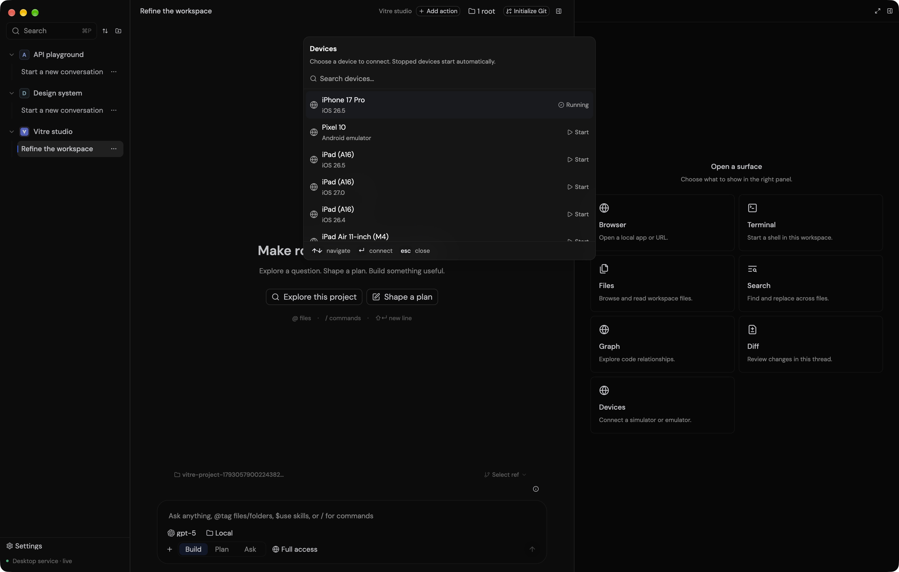
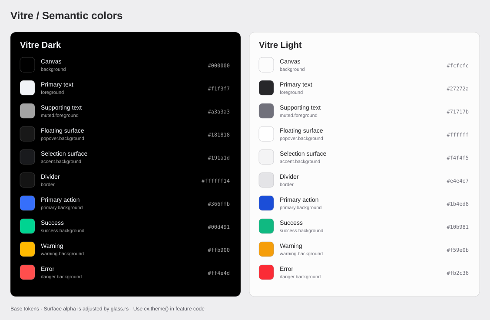

# Vitre design language

Use this directory when building or changing Vitre's native UI. It records the
shared visual rules, the components that implement them, and images from the
running app. The native source and theme tokens are the implementation authority;
update these references with intentional changes to the language.

## Start here

1. Read [foundations](foundations.md) for color, type, spacing, and materials.
2. Find the matching pattern in [components](components.md). Open its linked source.
3. Compare the feature with the [visual references](images/README.md).
4. Follow [verification and maintenance](verification.md) before handing it over.

## Character

- **Calm workspace.** Keep conversation and working content prominent. Utility
  controls use compact geometry, muted labels, and restrained borders.
- **Clear hierarchy.** Use a short primary label, quieter supporting information,
  and a separate trailing action or status. Align choice lists to the left.
- **Consistent families.** A new item in a grid, menu, toolbar, or picker inherits
  that family's renderer, padding, icon scale, and interaction.
- **Purposeful color.** Neutral surfaces organize the app. Blue identifies primary
  actions and focus. Semantic colors describe success, warning, and failure.
- **Native interaction.** Search, arrow keys, Enter, Escape, focus restoration,
  pointer hover, and scrolling belong to the component, alongside its appearance.
- **Readable glass.** Use the existing material helpers and respect the user's
  transparency and motion preferences.

## Reference images

### Workspace and surface cards

The Devices entry uses the same card structure as Browser, Terminal, Files,
Search, Graph, and Diff. The selected thread, quiet toolbar, and composer show
the hierarchy around those cards.

### Searchable choices

The Devices picker shares the command palette's search field, row selection,
scrolling, and keyboard footer. Device name, runtime, and state occupy distinct
positions. The reference includes both running and stopped devices.

### Color tokens

These samples are generated from the native theme file. Actual glass appearance
also depends on the backdrop and transparency setting.

Lens and native inline visualizations use the [content and metric patterns](components.md#lens-overview-and-inline-visuals). See [Lens behavior and QA](../lens.md).
