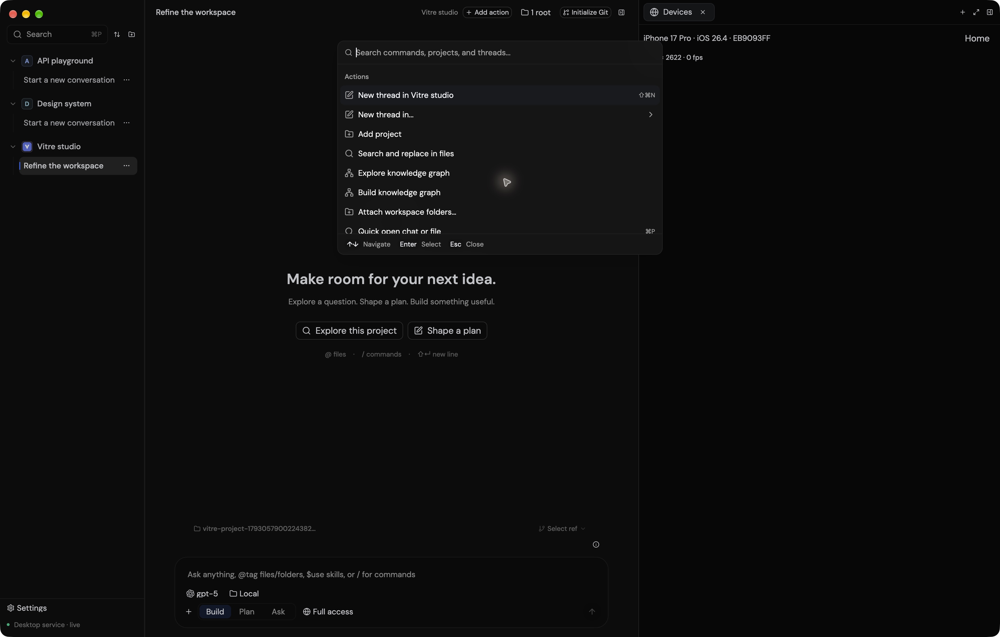
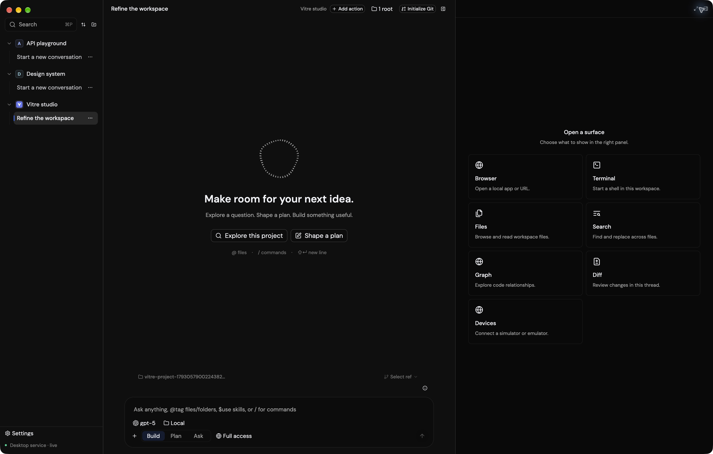
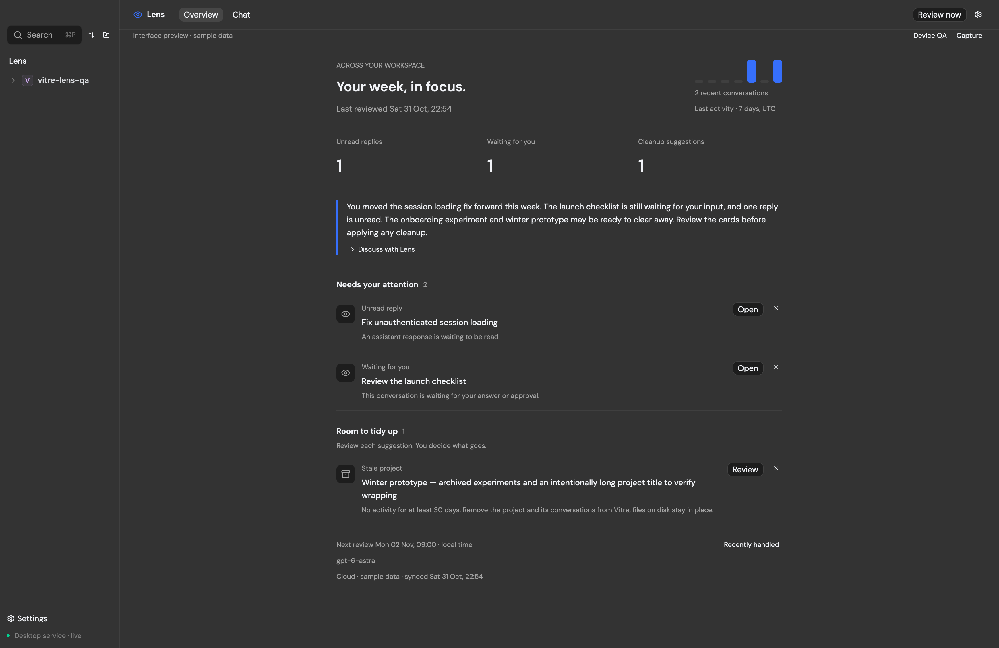
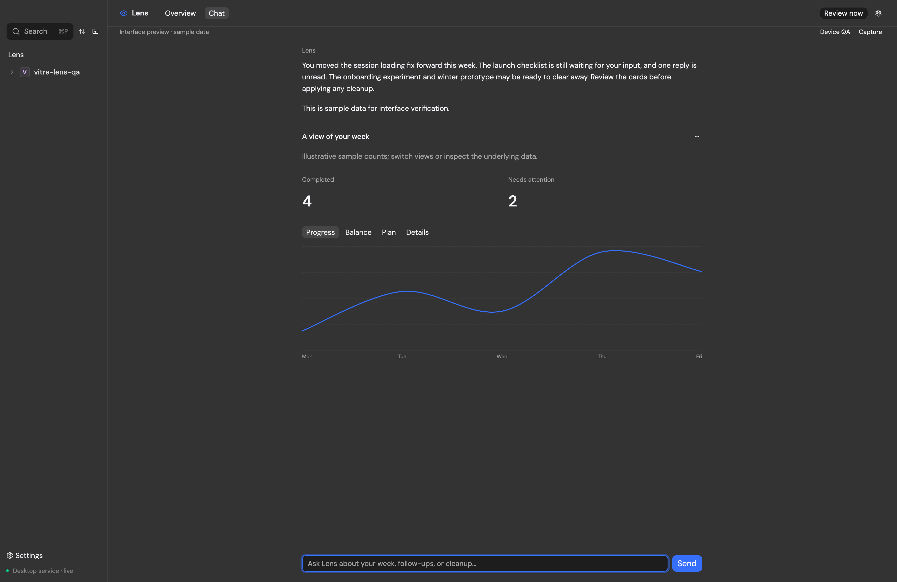
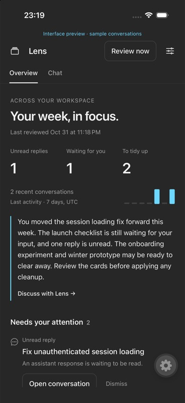

# Component patterns

## Pick the existing family

| User task                              | Pattern                                                           | Native reference                                                                                                               |
| -------------------------------------- | ----------------------------------------------------------------- | ------------------------------------------------------------------------------------------------------------------------------ |
| Search and choose a resource/action    | `CommandState`, `Command`, `CommandItem` in a `Dialog`            | [Command palette](../../crates/vitre-app/src/palette/command_palette.rs), [Devices](../../crates/vitre-app/src/chat/mobile.rs) |
| Find a file or content                 | Quick Search with result preview                                  | [quick_search.rs](../../crates/vitre-app/src/palette/quick_search.rs)                                                          |
| Choose a workspace surface             | Shared card grid                                                  | [right_panel.rs](../../crates/vitre-app/src/chat/right_panel.rs)                                                               |
| Perform an action                      | Shared `Button` and its size/variant                              | [Button](../../third_party/gpui-component/crates/ui/src/button/button.rs)                                                      |
| Edit settings or submit a form         | Shared input/form controls in the existing settings/dialog layout | [settings/forms.rs](../../crates/vitre-app/src/settings/forms.rs)                                                              |
| Explain an action or report its result | Shared tooltip or notification                                    | [polish.rs](../../crates/vitre-app/src/chat/polish.rs)                                                                         |
| Keep work alongside chat               | Dock surface with the shared tab strip                            | [right_panel.rs](../../crates/vitre-app/src/chat/right_panel.rs)                                                               |

## Searchable picker

Use the command palette family for a list that can grow. It provides search,
selection, virtual scrolling, and keyboard confirmation.

**Anatomy:** compact optional context header → search field → left-aligned rows
→ quiet keyboard footer. Each row has a small leading icon, a flexible label
column, and an optional trailing state/action. Put runtime, location, provider,
or other disambiguation on the muted secondary line. Show raw identifiers only
when otherwise identical choices need distinguishing; keep them searchable.

**Implementation:** use `Command::bordered(false)` inside the existing zero-padding
dialog. Keep its background transparent so the dialog's material supplies the
surface. Use `CommandItem::label`/`keywords` even with custom row content so search
continues to work. Resolve confirmation against the original item index returned
by the component. Use [the shared footer](../../crates/vitre-app/src/palette/chrome.rs)
for arrow, Enter, and Escape hints. Focus the query after the dialog mounts.

**States:** show a helpful empty inventory message, a separate no-results message,
visible selection, and readable running/stopped labels. Escape closes the picker
even with text entered. Selecting a stopped device opens its panel with a starting
state, then connects when booting finishes. Errors should explain the next action.

**Avoid:** a stack of outlined, centered action buttons for selectable records;
concatenating every property into one equally prominent line; decorative badges
on every item; manually implementing arrow-key navigation and scroll behavior.

## Buttons and toolbar actions

Use `Button` variants consistently with adjacent actions. Quiet toolbar controls
normally use a small/extra-small ghost treatment; standalone secondary actions
use the existing outline treatment. Reserve primary styling for the main action
of the current task. Match icon, height, padding, and radius within a toolbar.

Keep labels brief and action-oriented. Disabled controls retain a readable label
and explain the reason where useful. A choice row uses the selection family above.

Device controls use extra-small ghost buttons. **Stop** shuts down the selected
device; the tab's **Close** disconnects the display. Show **Stopping…** in place
while shutdown is pending, disable duplicate actions and input, then display a
short stopped status with a path to start again. Shutdown failures remain visible
and allow a retry.

See the [running toolbar](images/device-toolbar-light.png) and
[stopped state](images/device-stopped-light.png) in the native app.

## Surface cards

Extend the existing surface-card renderer. Every card has the same icon position,
padding, title weight, border, hover state, and description style. Equal column
wrappers keep the final odd card at the same width as its neighbors. The Devices
card belongs to this family; its click can open a picker without changing its style.

## Dialogs, panels, and state

Use `WindowExt::open_dialog` and the shared dialog layer for modal work. The
component owns material, entrance/resize motion, dismissal, and focus behavior.
Forms may use the normal title/body/footer layout. Searchable choice dialogs use
the compact command layout. Constrain growing content to a real scroll viewport.

Dock panels preserve the surrounding conversation. Keep their title and actions
in the shared toolbar scale. Loading, starting, empty, and error states need short,
specific copy. A device boot should remain visibly in progress until it is ready;
buttons that need an active connection stay disabled during startup.

The chat composer owns typing whenever it is focused. Embedded native views must
release keyboard focus when a picker or text input is selected. Verify this in
the native application because a static image cannot establish input routing.

## Lens overview and inline visuals

[Native Lens](../../crates/vitre-app/src/lens.rs) keeps account-wide review work
outside project conversations. Its Overview uses a constrained reading column,
unboxed headline metrics, compact activity bars, a short summary, and quiet rows
for attention and cleanup. Keep the chat transcript in its own tab. The review
action stays available in either tab and does not depend on scheduling being on.

Use the shared searchable command picker for model selection on desktop. Mobile
uses left-aligned search rows with model, provider, and a selected checkmark. An
explicit model can be chosen before the user has used it in a conversation.

[Inline visuals](../../crates/vitre-app/src/visuals.rs) follow the same content
hierarchy: a small title and provenance, large headline figures, quiet view tabs,
a compact chart, and an overflow menu for data/source/copy/reset. Avoid boxing
every visual in a contrasting card or filling a toolbar with utility actions.
Use theme accents sparingly and retain an equivalent data view.

Long names wrap; long reasons have a details action. Cleanup always has a separate
confirmation describing its scope, with visible Cancel and action buttons. A
model response or chart interaction cannot approve cleanup.

Virtualize growing histories. Reuse the stable Markdown extension registry and
cached parsed message state; registering a fresh plugin each frame invalidates
Markdown and makes scrolling expensive. Preserve scroll and visual selections
when an unchanged poll arrives.

